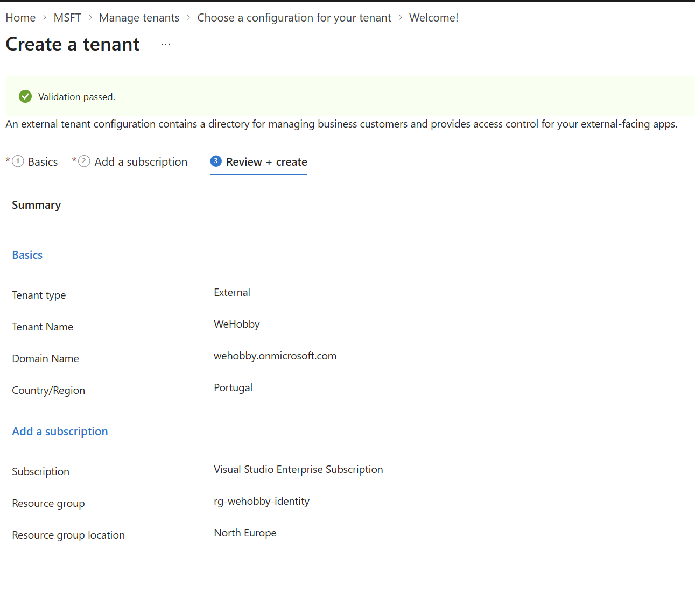
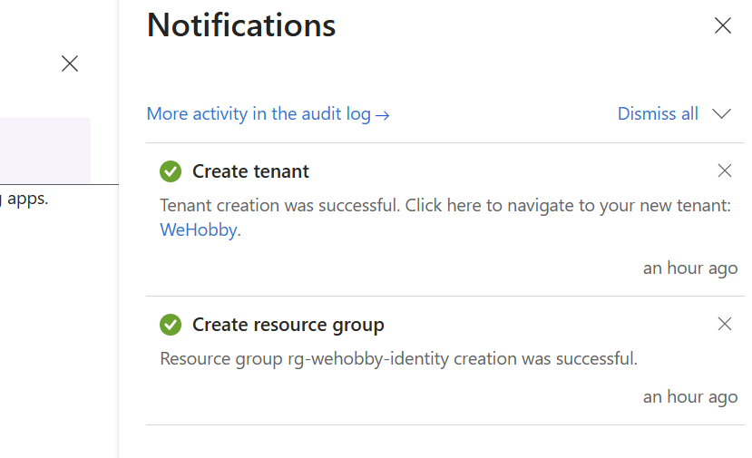
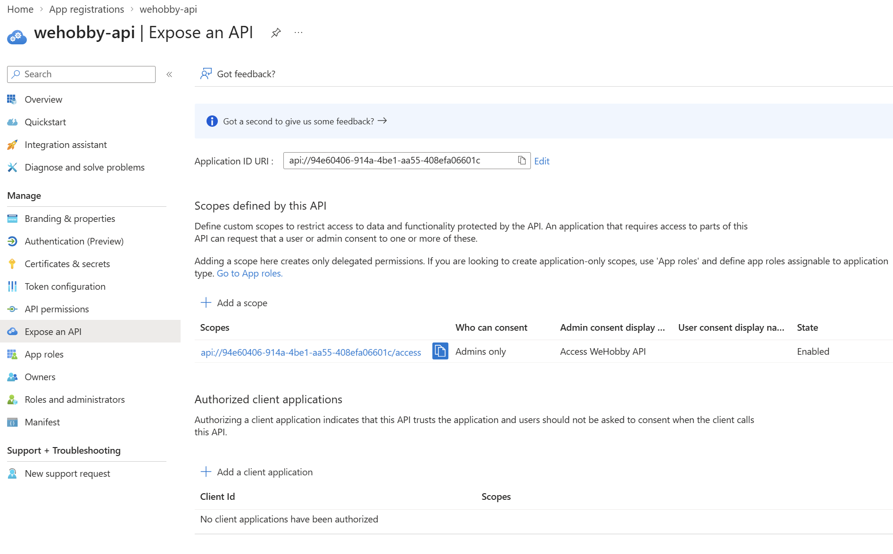
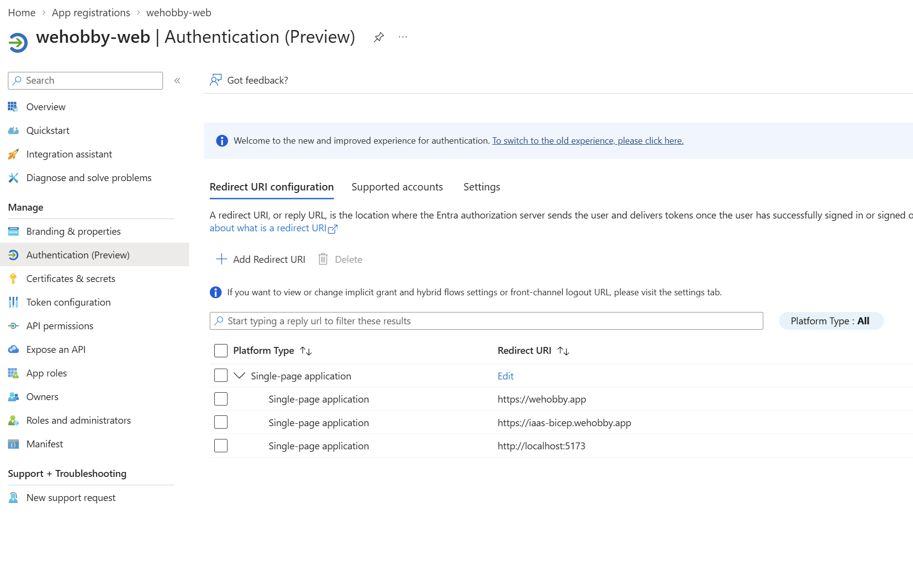
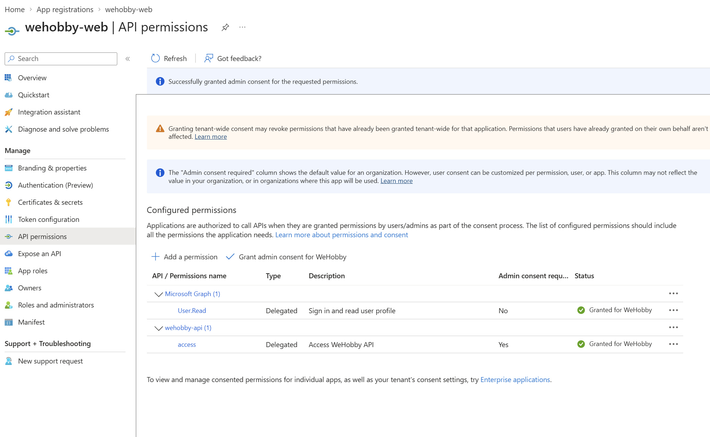
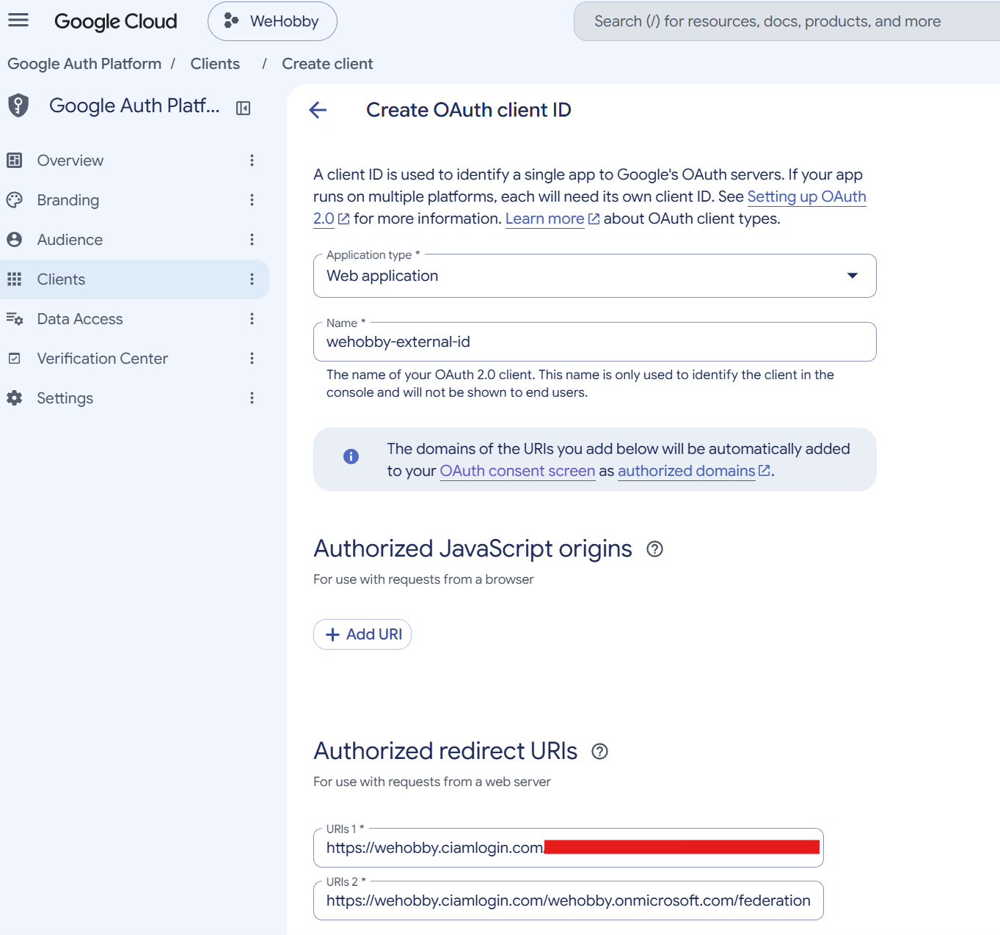
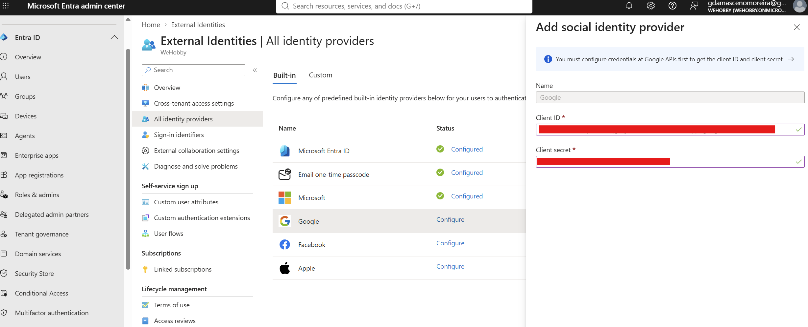
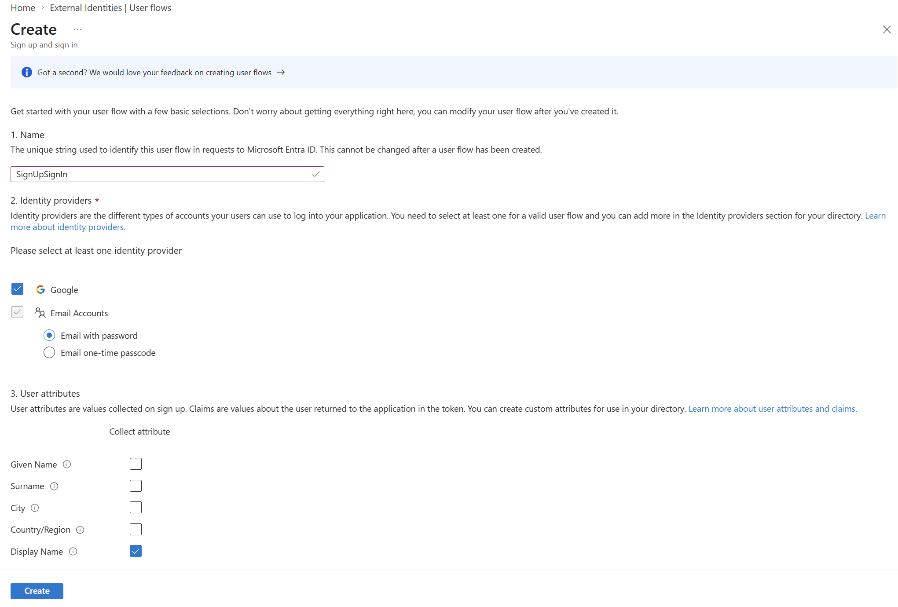

# Scenario 1: Authentication with Microsoft Entra External ID

This guide sets up sign in for WeHobby using **Microsoft Entra External ID**, the Azure service for customer facing identity (CIAM). Users can sign up and sign in with their email or their Google account. The web app (SPA) gets tokens from Entra and sends them to the API, which validates them before answering.

## Overview

| Component | What it is | Why it exists |
|---|---|---|
| External tenant | A separate Entra directory for app users | Keeps customers apart from the workforce tenant that owns the Azure subscription |
| `wehobby-api` | App registration for the backend | Defines the API as a protected resource with an `access` scope |
| `wehobby-web` | App registration for the frontend (SPA) | Lets the browser sign users in and request tokens for the API |
| Google OAuth client | Credentials created in Google Cloud | Allows Entra to federate with Google for "Sign in with Google" |
| User flow | The sign up / sign in experience | Defines which login methods and user attributes are offered |
| VM `.env` | IDs stored on the VM | Tells the containers which tenant and apps to trust |

None of the IDs used here are secrets: client IDs and the tenant ID are public by design and appear in tokens and in the browser. The only secret is the **Google client secret**, which is stored in Entra only.

## 1. Create the External ID tenant

An External ID tenant is a dedicated directory for the app's users. Creating it separately means customer accounts never mix with the workforce directory, and it has its own branding, policies and user flows.

1. Go to https://entra.microsoft.com, signed in to the workforce tenant (the one that owns the Azure subscription).
2. **Entra ID > Overview > Manage tenants > Create**.
3. Choose **External** (external configuration) > **Continue**.
4. **Basics**:
   - Tenant name: `WeHobby`
   - Domain name: `wehobby` (this becomes `wehobby.onmicrosoft.com` and `wehobby.ciamlogin.com`)
   - Location: Portugal
5. **Add a subscription**: select the subscription and a dedicated resource group, `rg-wehobby-identity`. The first 50,000 monthly active users are free.
6. **Review + create**. Provisioning can take up to 30 minutes.

> A dedicated resource group keeps the tenant safe when the scenario resource groups are deleted and redeployed with Bicep or Terraform, and shows identity as a separate line in cost reports.





7. Switch to the new tenant: gear icon (top right) > **Directories + subscriptions** > **Switch**.
8. From **Entra ID > Overview**, note:
   - **Tenant ID**: the GUID
   - **Subdomain**: the part before `.onmicrosoft.com` in the primary domain (`wehobby`)

> Everything from here on happens inside the new external tenant.

## 2. Register the API (`wehobby-api`)

The API needs its own app registration so Entra can issue tokens whose audience is the API. Exposing a scope (`access`) lets the web app ask for permission to call it on behalf of the signed in user.

1. **Entra ID > App registrations > New registration**.
2. Name: `wehobby-api`. Account type: **Accounts in this organizational directory only**. No redirect URI (the API never signs anyone in).
3. **Register**. Note the **Application (client) ID**.
4. **Expose an API > Application ID URI > Add**: accept the default `api://<api-client-id>` > **Save**.
5. **Add a scope**:
   - Scope name: `access`
   - Who can consent: **Admins only**
   - Admin consent display name: `Access WeHobby API`
   - Admin consent description: `Allows the WeHobby web app to call the API on behalf of the signed in user.`
   - State: **Enabled** > **Add scope**



6. Open **Manifest** and check that `requestedAccessTokenVersion` (or `accessTokenAcceptedVersion` in the old view) is `2`. Set it if it is `null`. External ID tenants issue v2 tokens, and the API validates the v2 issuer.

The full scope string the SPA requests is `api://<api-client-id>/access`.

## 3. Register the web app (`wehobby-web`)

The frontend is a single page application, so it is registered with the **SPA** platform. This enables the authorization code flow with PKCE, which is the secure option for browser apps (no client secret, no implicit flow). Redirect URIs list every address the app is served from, because Entra only returns tokens to URIs it knows.

1. **App registrations > New registration**.
2. Name: `wehobby-web`. Account type: **Accounts in this organizational directory only**.
3. Redirect URI: platform **Single-page application (SPA)**, value `https://wehobby.app` > **Register**.
4. Note the **Application (client) ID**.
5. **Authentication > Single-page application > Add URI**:
   - `https://iaas.wehobby.app`
   - `https://iaas-bicep.wehobby.app`
   - `http://localhost:5173` (local development with Vite)
   - **Save**. Leave implicit grant (access tokens and ID tokens) unticked.



6. **API permissions > Add a permission > APIs my organization uses** > `wehobby-api` > **Delegated permissions** > tick `access` > **Add permissions**.
7. Make sure Microsoft Graph delegated `openid` and `offline_access` are listed. `openid` is required for sign in and `offline_access` gives refresh tokens so users stay signed in.
8. **Grant admin consent for WeHobby > Yes**. Every row should show a green **Granted** status, so users are never asked to consent themselves.



## 4. Add Google as an identity provider

Entra federates with Google: the user clicks "Sign in with Google", Google authenticates them and sends the result back to Entra, and Entra issues the WeHobby tokens. The app itself never talks to Google.

### 4a. Google Cloud

1. https://console.cloud.google.com > create a project named `WeHobby`.
2. **APIs & Services > OAuth consent screen > Get started** (Google Auth Platform):
   - App name: `WeHobby`
   - User support email: own email
   - Audience: **External** (any Google account can sign in)
   - Contact information: own email
   - Accept the policy > **Create**
3. **Branding**:
   - App logo: left empty (uploading one triggers Google brand verification)
   - Application home page: `https://wehobby.app`
   - Privacy policy link: `https://wehobby.app/privacy`
   - Authorized domains: `wehobby.app`, `ciamlogin.com`, `microsoftonline.com`
   - Developer contact email: own email > **Save**
4. **Data access**: scopes `openid`, `.../auth/userinfo.email` and `.../auth/userinfo.profile` only. These are non sensitive, so no Google review is needed.


5. **Audience > Publish app** > **Confirm** (status: In production). In Testing mode, only listed test users can sign in.
6. **Clients > Create client**:
   - Type: **Web application**, name `wehobby-external-id`
   - Authorized redirect URIs (where Google sends the user back to Entra):
     - `https://wehobby.ciamlogin.com/e9af1ebf-3856-4c2b-8c18-0a3ebbc7cf47/federation/oauth2`
     - `https://wehobby.ciamlogin.com/wehobby.onmicrosoft.com/federation/oauth2`
7. **Create**. Copy the **Client ID** and **Client secret**. The secret goes into Entra only, never into the VM or the repository.



> If Google shows `redirect_uri_mismatch`, the error page shows the exact URI it received. Add that one to the list.

### 4b. Entra

1. **Entra ID > External Identities > All identity providers > Built-in** tab > **Google > Configure**.
2. Name: `Google`, paste the Client ID and Client secret > **Save**.



## 5. Create the user flow

The user flow is the hosted sign up and sign in page. It decides which login options appear and which attributes are collected at sign up. Linking it to `wehobby-web` makes that app use this experience.

1. **External Identities > User flows > New user flow**.
2. Name: `SignUpSignIn`.
3. Identity providers:
   - Email accounts: **Email one-time passcode** or **Email with password**
   - Social identity providers: **Google** (only appears after step 4b)
4. User attributes: at least **Display Name**.
5. **Create**.
6. Open the flow > **Applications > Add application** > select `wehobby-web` > **Select**.



## 6. Configure and deploy on the VM

The containers read the tenant and app IDs from `/opt/wehobby/.env`. Docker Compose passes them to the API (to validate tokens) and to the web container (to build the sign in URL). `IMAGE_TAG` selects the image built with the authentication code.

1. SSH into the VM and open the env file:

   ```bash
   sudo nano /opt/wehobby/.env
   ```

2. Keep `POSTGRES_PASSWORD` and `SITE_ADDRESS` as they are, update `IMAGE_TAG`, and add the four authentication values:

   ```bash
   IMAGE_TAG=sha-<7 character commit sha>

   # Entra External ID
   AUTH_TENANT_ID=<tenant-id>
   AUTH_TENANT_SUBDOMAIN=wehobby
   AUTH_API_CLIENT_ID=<wehobby-api client id>
   AUTH_WEB_CLIENT_ID=<wehobby-web client id>
   ```

   | Variable | Where to find it |
   |---|---|
   | `IMAGE_TAG` | GitHub > Actions > **images** workflow run summary |
   | `AUTH_TENANT_ID` | External tenant > Entra ID > Overview > Tenant ID |
   | `AUTH_TENANT_SUBDOMAIN` | Primary domain without `.onmicrosoft.com` |
   | `AUTH_API_CLIENT_ID` | App registrations > `wehobby-api` > Application (client) ID |
   | `AUTH_WEB_CLIENT_ID` | App registrations > `wehobby-web` > Application (client) ID |

   No quotes and no spaces around `=`.

3. Save with **Ctrl+O**, **Enter**, then exit with **Ctrl+X**.

4. Restrict the file to root, since it also holds the database password:

   ```bash
   sudo chmod 600 /opt/wehobby/.env
   ```

5. Pull the new images and recreate the containers:

   ```bash
   cd /opt/wehobby
   sudo docker compose pull && sudo docker compose up -d
   ```

6. Check that every container is running and the API started without errors:

   ```bash
   sudo docker compose ps
   sudo docker compose logs -f api
   ```

   If Compose stops with `set AUTH_... in .env`, one of the four variables is missing or misspelled.

## 7. Test

1. Open https://wehobby.app and https://iaas-bicep.wehobby.app.
2. Sign up with an email account, then sign out and sign in again.
3. Sign in with a Google account.
4. Confirm the new users appear in the external tenant under **Entra ID > Users**.

## Troubleshooting

| Symptom | Likely cause |
|---|---|
| `AADSTS50011` redirect URI mismatch | The address in the browser is not listed in `wehobby-web` > Authentication |
| Google `redirect_uri_mismatch` | The URI shown in the error is missing from the Google client |
| Google button missing on sign in page | Google not added to the user flow, or `wehobby-web` not linked to the flow |
| API returns 401 | Wrong `AUTH_API_CLIENT_ID` or `AUTH_TENANT_ID`, or token version not set to `2` |
| Compose refuses to start | An `AUTH_*` variable missing from `.env` |